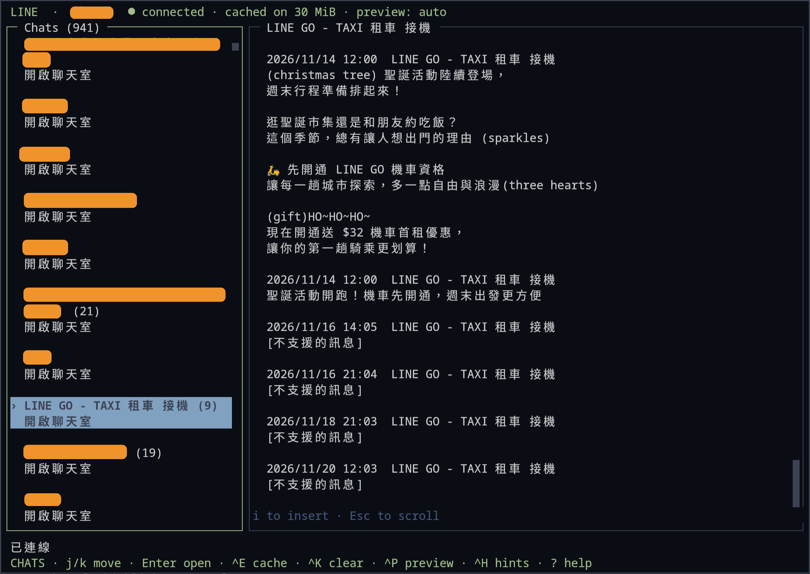

# tuiline — LINE in terminal

> This is an AI generated application and will not be actively maintained. It is intended to have minimal usability without spending much of my time, as a result of me being forced to use it by workplace culture.

Original repo from [tuigram](https://github.com/leonid-shutov/tuigram)



An OpenTUI client for LINE Messenger with its Go backend included in
[`backend/`](backend/). The interface stays in the terminal: chats on the left,
conversation history on the right, and a keyboard-operated composer.

## Run

Requires [Node.js 26.4+ and Go 1.26+](INSTALL.md). No other repository checkout is needed:

```sh
npm ci
npm run build:line
npm run dev
```

The build compiles the bundled backend into `backend-bin/line-gui` and applies
this client's patches, including support for up to 5,000 chats.
See [backend/UPSTREAM.md](backend/UPSTREAM.md) for source attribution.

Run these commands from the `tuiline` repository root. `npm run dev`
automatically uses `./backend-bin/line-gui`; no backend path is needed.

Try fictional chats without signing in or contacting LINE:

```sh
npm run dev -- --demo
```

## Keys

The interface uses your terminal's default foreground/background and ANSI 16-color
palette, including its green accent. Selections and reply highlights use palette
colors too, so your terminal theme controls the UI rather than fixed RGB colors.
Selected chats and messages outside reply threads use ANSI blue (slot 4) with
bold black text (slot 0). Picker highlights also use blue (slot 4).
Reply threads alternate black and bright-black
backgrounds (slots 0 and 8, corresponding to SGR 40/100), with white text (slot 7);
the `›` marker indicates the selected message within a thread.

The package and command are named `tuiline` (`node bin/tuiline.js` or `npm run dev`
from this checkout). Upstream attribution and legacy saved-data compatibility keep
their original names.
The npm installer requires a published `tuiline` release; renaming this checkout
does not publish one. The source-build instructions above work without npm publication.

| Key                      | Action                                                          |
| ------------------------ | --------------------------------------------------------------- |
| Up/Down, j/k             | Select a sidebar chat or move the message cursor in scroll mode |
| H / M / L                | Select top / middle / bottom visible chat or message            |
| k at first / j at last   | Load the previous / next saved 100-message history page         |
| h / l                    | Leave / enter conversation focus (outside insert mode)          |
| Tab                      | Switch sidebar / conversation scroll mode                       |
| Enter from sidebar       | Focus conversation in scroll mode                               |
| @ in insert mode         | Search group members and insert a LINE mention                  |
| i                        | Enter insert mode                                               |
| s                        | Browse owned stickers; Enter previews, Enter again sends        |
| l on an image or sticker | Fit full height; l again fills width; j/k scroll                |
| l on a video             | Play inside the right pane; h, q, or Escape returns             |
| Enter in insert mode     | Send text                                                       |
| Shift+Enter in insert    | Insert a newline (enhanced keyboard support required)           |
| Escape                   | Return to scroll mode, preserving your draft                    |
| Ctrl+F / Ctrl+B          | Move a full page down / up in the focused pane (not insert)     |
| Ctrl+D / Ctrl+U          | Move half a page down / up in the focused pane (not insert)     |
| gg / G                   | Jump to the top / bottom of the focused list                    |
| PageUp/PageDown          | Full page up / down in the focused pane (not insert)            |
| g then x                 | Open links in the marked message; pick a link if several        |
| Ctrl+R                   | Refresh                                                         |
| Ctrl+N                   | Test Linux desktop notification delivery (live mode)            |
| Ctrl+E                   | Enable/disable persistent media caching                         |
| Ctrl+K                   | Clear saved media (not chat history or Downloads)               |
| Ctrl+P                   | Toggle automatic inline image previews                          |
| Ctrl+O                   | Enable/disable automatic mark-as-read                           |
| Ctrl+M                   | Mute/unmute the selected chat across LINE clients               |
| Ctrl+H outside insert    | Hide/show bottom keybind hints                                  |
| ? outside insert         | Open scrollable keybind help; ? or Escape closes it             |
| Ctrl+S in scroll mode    | Save the selected attachment to your system Downloads folder    |
| Ctrl+T                   | Pick files and upload them immediately to the current chat      |
| Ctrl+I                   | Pick PNG/JPEG images and send native LINE photo messages        |
| Left click               | Select the clicked chat or message                              |
| Ctrl+L                   | Start or retry QR login                                         |
| Ctrl+Y                   | Confirm login when requested                                    |
| Ctrl+X                   | Cancel login                                                    |
| Ctrl+C                   | Quit                                                            |

`H/M/L` and paging shortcuts navigate only outside insert mode. In insert mode,
typing and editor keybindings remain unchanged.

The composer supports multiline editing and pasted text. It grows up to five
rows, shrinks to the available pane space, then scrolls internally; Enter sends
the complete draft. If no interior row fits, the editor is hidden until the
terminal grows again, without discarding its draft. Shift+Enter needs
a terminal that reports it distinctly from Enter. Drafts, replies, and group
mentions retain their line breaks. Ctrl+Z undoes edits; Ctrl+Shift+Z redoes them.

History-cache updates use an ordered background writer and are drained on normal
shutdown. Abrupt process termination can lose queued cache updates; LINE remains
the source of truth. Credential and request-sequence persistence is unchanged.

Upload progress, completion notices, and other status messages appear alongside
`已連線` on the same status row. Only an active reply uses a separate reply banner.

File transfers support up to **20 MiB per file**. Ctrl+S saves the selected file,
image, video, or audio attachment directly to your system Downloads folder (XDG),
adding a numeric suffix when the filename already exists; existing files are never
overwritten. Ctrl+T opens [Yazi](https://yazi-rs.github.io/docs/installation/) in the
same terminal. With Yazi's default keybindings, press **Space** to select each file,
then **Enter** to confirm and upload the selection immediately; press **q** to cancel.
Tuiline restores its interface when Yazi closes. Yazi does not need a desktop session.

Ctrl+T always sends file attachments, including image files. Ctrl+I uses the same
picker but sends native photos with LINE previews. Photos must be valid PNG/JPEG,
at most 20 MiB, 8192 pixels per side, and 32 megapixels. Encrypted photos upload
the same encrypted image as both original and preview (twice the upload bandwidth);
plain photos upload only the original and let LINE generate previews. Ctrl+I requires enhanced keyboard
support: legacy terminals send the same code for Ctrl+I and Tab, which remains
pane navigation.

Uploads do not lock navigation: scroll messages, switch panes, or click another
chat while sending. Switching chats or pressing Escape stops the remaining queue,
but cannot retract an in-flight send. The status line shows transfer progress;
other sends stay disabled until the active request finishes. Success uses LINE's
send acknowledgement, not an extra delivery-verification request. Attachment
requests have a 90-second deadline; a timeout reports “Delivery unconfirmed—check
LINE before retrying” without blocking navigation or automatically resending.
Photo failures identify the failing stage (original upload, encrypted preview, or
send acknowledgement) without exposing server bodies or writing diagnostic logs.
Media completion and preview-update events update only the affected message,
without a blocking full-account refresh. Confirmed uploads release Ctrl+I for the
next photo immediately; inline thumbnails reuse the uploaded bytes locally.

Clicking a chat selects and opens it; clicking a message marks that message in
scroll mode. Modal views block selection clicks, and drafts are retained.

If `yazi` is not installed on your `PATH` or cannot launch, enter paths in the
terminal prompt. Separate multiple paths with spaces and quote names containing
spaces, for example:

```text
~/photo.jpg "/home/me/Documents/my report.pdf" './another file.zip'
```

Absolute paths, relative paths (from tuiline's working directory), and `~/` paths
are supported. Paths are literal: wildcards, environment variables, and shell
commands are not expanded. Press Enter to upload immediately, or Escape to cancel
the path prompt. Canceling Yazi does not open the path prompt. Files are sent
individually, preserving your text draft. An uncertain send stops the queue:
check LINE before retrying.
Rebuild the backend with `npm run build:line` after updating.

In a group chat, press `i` to type, then type `@` to list group members.
Type part of a name to filter, use Up/Down to select, and press Enter or Tab
to insert the mention. Press Escape to close the list. After composing your
message, press Enter to send it with native LINE mention metadata. You can
include up to 20 mentions and combine mentions with a reply.

Scan the QR code in the terminal using LINE on your phone, then follow the
PIN/confirmation prompts. Authentication and encryption remain managed by the
reference backend, including its Secret Service requirements. This client uses
the same saved account as that backend. Avoid simultaneous clients using the
same session if the backend reports it is locked.

Login progress and failure messages are saved to
`$XDG_CACHE_HOME/tuiline/tuiline-login.log` (normally
`~/.cache/tuiline/tuiline-login.log`), with private directory and file
permissions. Existing logs in the working directory are not moved; remove
them manually if no longer needed.
Press `Ctrl+C` to quit and print the recent login diagnostics in the terminal,
or watch them from another terminal:

```sh
tail -F "${XDG_CACHE_HOME:-$HOME/.cache}/tuiline/tuiline-login.log"
```

The log excludes PINs, QR data, credentials, and chat contents.

This version supports listing chats, loading the latest history, text sending,
live incoming updates, and terminal image rendering. In scroll mode, the `›`
marker identifies the selected message; `l`/`L` opens links from that message.
Uppercase `J`/`K`/`H`/`L` also work for navigation.
By default, visible photo messages load sanitized thumbnails automatically (up to
two concurrent downloads); scrolling away stops queued requests. Press `Ctrl+P`
to switch to selected-image-only previews and back. The header shows
`preview: auto` or `preview: selected`, and the choice persists per account.
Full-size PNG/JPEG previews (up to 2 MiB and 4096×4096) load only when opened.
Sticker images supplied by the backend render inline automatically.
The header also shows `cached on/off` and media-cache usage. Press `Ctrl+H`
outside insert mode to reclaim the bottom hints row; the setting persists across
restarts in `$XDG_CACHE_HOME/tuiline/settings.json` (normally
`~/.cache/tuiline/settings.json`), independently of whether media caching is
enabled. Existing private `hints-hidden` markers in the cache or config directory
are migrated automatically. Press `?`
outside insert mode for the complete, scrollable keybind list. It supports
`j`/`k`, arrow keys, PageUp/PageDown, and Ctrl+B/F/U/D; `?` or Escape closes it
without changing the conversation selection or draft.
Press `s` outside insert mode to browse owned sticker packs in a compact four-column
thumbnail grid. Use `h`/`l` to move left/right and `j`/`k` to move down/up;
arrow keys also work. The grid scrolls to keep the highlight visible. Use
`[`/`]` to switch packs, and `n`/`p` for pages. Enter selects a sticker for preview;
Enter again sends it, while Escape cancels. Clear any text draft before sending a
sticker. Sticker previews are static and silent, matching the reference backend;
custom text/name stickers remain unsupported.
Page navigation continues across pack boundaries; the header shows both the
overall page count and the current pack's pages. Generated backend labels and
the sticker picker use Traditional Chinese. Contact names, pack titles, and
message contents stay as received from LINE.
The preview cache evicts older images as you browse packs; the highlighted
sticker loads first. Press `r` to retry a missing preview.
OpenTUI chooses the terminal's image protocol, with Unicode blocks as a fallback.
Failed or unsupported images retain their text placeholder. Previews are held
in memory with a bounded cache and cleared when switching conversations.

Video playback requires mpv. Press `l` on a video to play it inside the right
pane while the chat list stays visible. `Space` pauses, left/right arrows seek
five seconds, and `h`, `q`, or Escape returns to the conversation. Frames update
at up to 12 fps using the terminal image protocol (or Unicode blocks as a fallback).
Escape also cancels a pending download.
Temporary video files are removed after playback. The backend limits downloads
to 20 MiB.

While a video downloads, the pane shows a progress bar with bytes received and,
when LINE supplies the total size, a percentage. Escape cancels the download.

Outgoing messages show `✓` after sending and `✓✓` when a live read receipt is
observed. In groups, this means at least one other member has read the message.
Live read receipts are saved with cached messages; older reads not observed by
this client cannot be inferred from LINE. New message activity moves its chat
to the top without changing the selected chat.
Tuiline sends LINE read receipts for visible messages in the focused conversation
(scroll or insert mode), after history finishes loading. Sidebar highlighting,
cached history still loading, help/media overlays, and an unfocused terminal do
not mark messages read. Focus detection relies on terminal focus-reporting
support. Receipts are coalesced and the unread badge clears only after a
successful receipt through the chat's newest message. Failures appear on the
status line; return to the conversation to retry.
Press `Ctrl+O` to disable or re-enable automatic read receipts; enabled is the
default. The header shows `mark read: on/off`. The preference persists per
account in the cache directory independently of disk media caching. Disabling
cancels queued receipts but cannot undo a receipt already sent to LINE.

Attachment sending, reactions, and message actions have no
TUI controls yet. LINE currently returns only the latest 100 messages for a chat;
older messages are saved when this client observes them over time, **not**
backfilled from the server. The complete observed text history is stored per
account under `$XDG_CACHE_HOME/tuiline/history/` (normally
`~/.cache/tuiline/history/`) and shown 100 messages at a time. On opening a chat,
cached messages appear while the latest server page loads; server edits and
deletions in that page replace stale cache entries. A 64 MiB per-chat file limit
and 512 MiB per-account budget evict older chat files when necessary. These
files contain **decrypted message text in plaintext** with private directory
(0700) and file (0600) permissions; they are not encrypted. Remove that
directory to erase saved conversations. Images and attachments are not stored
in this history cache.

Processed avatars, stickers, photo thumbnails and images expanded on demand
are cached separately in `$XDG_CACHE_HOME/tuiline/media/` (normally
`~/.cache/tuiline/media/`), isolated by account. The app checks memory, then
disk, then downloads. Avatar picture paths and sticker package/version/hash
changes cause new cache keys; previews are keyed by chat and message ID.
Owned sticker-pack metadata can appear while the app refreshes it from LINE;
the cached list cannot authorize sending before that refresh succeeds.
Original photos, videos, audio and other attachments are **not** cached
automatically. Successful unsend operations remove that message's saved
thumbnail and expanded preview. Media files are stored **unencrypted** with
private directory (0700) and file (0600) permissions. The default limit is
512 MiB per account; least-recently-used assets are evicted and media unused
for 90 days expires. Set `TUILINE_MEDIA_CACHE_MB` to an integer from 1 to 2048
to change the limit. The header shows cache usage; Ctrl+E persists the
enable/disable choice and Ctrl+K clears saved media without deleting text
history, preferences, or explicitly downloaded files. Already displayed images remain in
memory until the conversation changes or tuiline exits. Signing out does not
erase saved media; clear it explicitly if needed. The local build
supports 5,000 chats. Drafts live in memory.

Local toggle preferences use versioned JSON settings files with private directory
(0700) and file (0600) permissions. Hints are global; preview mode, automatic
mark-as-read, and media-cache enablement are per account in
`$XDG_CACHE_HOME/tuiline/accounts/<account-hash>/settings.json`.
Both files use `{"version":1,"preferences":{...}}` with boolean settings
(`hintsVisible` globally; `autoImages`, `markReadEnabled`, and
`mediaCacheEnabled` per account). Missing settings default to enabled.
Old `auto-images-off`, `mark-read-off`, and `disabled` cache markers migrate
automatically; existing JSON settings take precedence. Legacy markers are removed
only after their choices are saved successfully. Settings previously stored in
`$XDG_CONFIG_HOME/tuiline/` migrate to the corresponding cache paths automatically,
with existing cache settings taking precedence. Clearing or deleting the media
cache does not reset these preferences; deleting the entire tuiline cache does.

Uncertain sends are shown and blocked from
automatic resending; check LINE and refresh before deliberately trying again.
Desktop notifications are enabled through `notify-send` while the app is running.
Group notifications show the group name, sender, and message preview; direct
notifications show the sender and message preview.
Press `Ctrl+N` to test desktop delivery independently of incoming messages.
Delivery failures appear on the status line, including errors connecting to the
desktop session bus. A successful test means the desktop service accepted it;
Do Not Disturb settings and notification rules can still hide the popup.
`notify-send` must be available in the app's `PATH`, and tuiline must run in the
desktop user's D-Bus session. Notifications are grouped and rate-limited; old
replayed messages are not notified. New messages discovered by a background
refresh also notify, even in chats that are not selected. The initial chat list
establishes a baseline without notifying for existing history; opening older
history does not trigger notifications. Live events and refresh results share
deduplication so the same message cannot notify twice within the recent-message
window. Startup/replay detection uses message IDs, not a narrow server-timestamp
window. Delayed, missing, or clock-skewed message timestamps do not suppress new
notifications; queued notifications expire based on local receipt time.
Chats muted in LINE show `` after their name and do not produce desktop
notifications (a font containing this icon is required). `Ctrl+M` changes the selected chat's notification setting on LINE,
not just in tuiline; the setting is read back from LINE before the indicator changes.
Direct chats use `updateContactSetting`; groups and rooms use `updateChat` while
preserving the existing chat metadata. Failures show the operation stage and safe
error details on the status line, without writing diagnostic logs. Refresh
to pick up changes made on another device. In terminals that cannot distinguish
Ctrl+M from Enter, the mute shortcut requires an enhanced keyboard protocol.
Non-friend group senders have their display names resolved independently of
avatar loading and reused for later live messages.

Notification diagnostic tracing has been removed. Existing `notifications.log`
and `notifications.log.1` files in the cache directory are left untouched and
can be deleted manually. Delivery errors still appear on the status line.

The original Telegram implementation is available with `npm run dev:telegram`;
its original documentation is in [docs/TELEGRAM.md](docs/TELEGRAM.md). Existing
Telegram configuration is separate from the LINE backend's session.
